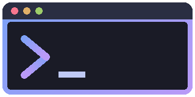

Front matter makes the cover
===

<!-- transition: slide -->

The slide you just left was generated from this YAML block, which
must start on the very first line of the file:

```yaml
---
title: tuipresent in 5 minutes
sub_title: Every slide shows a feature and the markdown behind it
author: tuipresent examples
date: 2026
theme: dark          # or nord, catppuccin-latte... (-themes)
transition: slide    # deck-wide default
---
```

<!-- pause -->

Title and author also feed the footer below. Slides are separated
by an `end_slide` comment on its own line.

<!-- end_slide -->

Titles, text and lists
===

<!-- transition: wipe -->
<!-- column_layout: [1, 1] -->
<!-- column: 0 -->

## Result

**Bold** for emphasis, *italic* for
asides, `code` for names.

* Short phrases
* One idea per slide
* Numbers beat adjectives

<!-- column: 1 -->

## Source

```markdown
Titles, text and lists
===

**Bold** for emphasis,
*italic* for asides,
`code` for names.

* Short phrases
* One idea per slide
* Numbers beat adjectives
```

<!-- reset_layout -->

A setext `===` heading before any other content becomes the title.

<!-- end_slide -->

Titles take **markdown** and a subtitle
===
<!-- subtitle: this one asks for `title_style: curly` -->
<!-- title_style: curly -->
<!-- transition: slide -->

The curly underline shows in kitty, Ghostty, WezTerm and iTerm2; elsewhere
the usual rule stays. `title_style: frame` boxes the title instead.

Body text has more styles: ==highlight==, ~~strikethrough~~,
[faint]{.faint}, ++underline++ and [curly]{.curly}.

> [!TIP]
> Callouts are boxes in the theme's colors: NOTE, TIP, IMPORTANT,
> WARNING and CAUTION.

<!-- end_slide -->

Pauses reveal one step at a time
===

<!-- transition: dissolve -->
<!-- column_layout: [1, 1] -->
<!-- column: 0 -->

## Source

```markdown
1. Measure first
<!-- pause -->
2. Change one thing
<!-- pause -->
3. Measure again
```

<!-- column: 1 -->

## Result

1. Measure first

<!-- pause -->

2. Change one thing

<!-- pause -->

3. Measure again

<!-- reset_layout -->

Press space to step: each new item fades in. The source sits in the
left column because a pause delays every column after it. For
instant reveals use `<!-- fade: off -->`, `fade: false` or `-fade=false`.

<!-- end_slide -->

Columns split the screen
===

<!-- transition: cover -->
<!-- column_layout: [3, 2] -->
<!-- column: 0 -->

This slide is a `[3, 2]` layout. Its source, trimmed:

```markdown
<!-- column_layout: [3, 2] -->
<!-- column: 0 -->
This slide is a ...
<!-- column: 1 -->
* Widths are relative
<!-- reset_layout -->
Back to full width.
```

<!-- column: 1 -->

* Widths are relative
* Columns are 0-based
* 4-cell gutter
* Any markdown inside

<!-- reset_layout -->

Back to full width after `reset_layout`.

<!-- end_slide -->

Code gets syntax highlighting
===

<!-- transition: slide -->
<!-- column_layout: [1, 1] -->
<!-- column: 0 -->

## Result

```go
func fib(n int) int {
    if n < 2 {
        return n
    }
    return fib(n-1) + fib(n-2)
}
```

<!-- column: 1 -->

## Source

````markdown
```go
func fib(n int) int {
    if n < 2 {
        return n
    }
    return fib(n-1) + fib(n-2)
}
```
````

<!-- reset_layout -->

Any language glamour knows: go, rust, python, sql, yaml, diff...

<!-- end_slide -->

Walk through code line by line
===

<!-- transition: slide -->

Put line groups in braces after the language. Each `|` is a step; the
other lines dim. Press space to move through them.

```go {1|2-4|5|all}
func fib(n int) int {
    if n < 2 {
        return n
    }
    return fib(n-1) + fib(n-2)
}
```

The source: ` ```go {1|2-4|5|all} `. `{2-4}` alone is a static highlight, and
`+exec` blocks take groups too.

<!-- end_slide -->

Add +exec and press e
===

<!-- transition: none -->
<!-- column_layout: [1, 1] -->
<!-- column: 0 -->

## Source

````markdown
```bash +exec
date "+%a %d %b %Y %H:%M"
uname -s
```

```python +exec
import math
print(math.comb(52, 5))
```
````

<!-- column: 1 -->

## Live

```bash +exec
date "+%a %d %b %Y %H:%M"
uname -s
```

```python +exec
import math
print(math.comb(52, 5))
```

<!-- reset_layout -->

Press `e`: both blocks run and their output appears below them.

<!-- end_slide -->

Charts are just text
===

<!-- transition: wipe -->
<!-- column_layout: [1, 1] -->
<!-- column: 0 -->

## Result

```text
Mon  ███████▌        7.5
Tue  ████████████   12.0
Wed  █████████▏      9.2
Thu  ██████████████ 14.1
Fri  ████▍           4.4
```

Commits per day, last week.

<!-- column: 1 -->

## Source

````markdown
```text
Mon  ███████▌        7.5
Tue  ████████████   12.0
Wed  █████████▏      9.2
Thu  ██████████████ 14.1
Fri  ████▍           4.4
```
````

<!-- reset_layout -->

A `text` fence keeps alignment and skips highlighting. Tables work too.

<!-- end_slide -->

Pictures, too
===

<!-- transition: wipe -->
<!-- column_layout: [1, 1] -->
<!-- column: 0 -->



<!-- column: 1 -->

## Source

```markdown

```

* PNG, JPEG or GIF
* kitty, ghostty, iTerm2, WezTerm, foot: real pixels
* Elsewhere: half-blocks
* Scaled to fit, aspect kept

<!-- reset_layout -->

Give the image a line of its own. A missing file shows `[image: alt]`.

<!-- end_slide -->

Photographs fill the slide
===

<!-- transition: cover -->


*Mountain goat, Mount Evans, Colorado.* The image takes every row the slide leaves free.

<!-- speaker_note: A real 3:2 photo. In kitty, ghostty, iTerm2, WezTerm or foot this is full resolution (each uses its own image protocol); elsewhere it falls back to half-blocks at the same size. -->

<!-- end_slide -->

<!-- jump_to_middle -->
<!-- transition: dissolve -->

Say one thing. Loudly.
===

A centered statement slide, made with:

```markdown
<!-- jump_to_middle -->
```

<!-- end_slide -->

Five ways to arrive
===

<!-- transition: cover -->
<!-- column_layout: [1, 1] -->
<!-- column: 0 -->

| Kind | Used on |
|------|---------|
| slide | code, front matter |
| wipe | text, charts |
| cover | columns, this one |
| dissolve | pauses, statement |
| none | the exec slide |

<!-- column: 1 -->

```markdown
<!-- transition: cover -->
```

Per slide, it overrides the front
matter default. Going backwards,
the departing slide's kind wins.

<!-- reset_layout -->

Try `-transition dissolve` on the command line to change the default.

<!-- end_slide -->

Edit while you present
===

<!-- transition: wipe -->
<!-- column_layout: [1, 1] -->
<!-- column: 0 -->

## Try it

Keep this deck open, then open
`examples/tour.md` in an editor
and change this sentence.

Save: the slide redraws within
half a second, on the same
slide and pause step.

<!-- column: 1 -->

## How it works

* Polls the file every 400 ms
* Rename-on-save editors work
* Bad saves keep the old deck,
  with the error shown below
* `-watch=false` turns it off

<!-- reset_layout -->

Handy when an agent writes the deck: watch each edit land live.

<!-- end_slide -->

Speaker notes stay off the slide
===

<!-- transition: slide -->
<!-- column_layout: [1, 1] -->
<!-- column: 0 -->

## Source

```markdown
<!-- speaker_note: Short -->


<!-- speaker_note:
- Or several lines
- of **markdown**
-->
```

<!-- column: 1 -->

## Presenting

```bash
tuipresent deck.md
tuipresent -notes deck.md
```

Run the second in a split
that only you can see.

<!-- reset_layout -->

The notes pane adds slide, step, next title and a clock.
Its arrow keys, `g`/`G` and numbers drive the slides too.

<!-- speaker_note: This slide has two notes. If you can read this, the notes view works. -->

<!-- speaker_note:
- Notes take **no rows** on the slide, so put talking points here
- The notes view follows this window; start either one first
- Quit the presenter and the notes view waits for it to come back
-->

<!-- end_slide -->

Getting around the deck
===

<!-- transition: slide -->

| Key | Does |
|-----|------|
| `o` | slide overview grid |
| `12` then `enter` | jump to slide 12 |
| click left / right third | back / forward |
| wheel | back / forward |

* In the overview: arrows or `hjkl` move, `enter` opens, `esc` closes
* While typing a number it shows on the status line; `esc` cancels
* `-mouse=false` leaves the mouse to the terminal, for copying text

<!-- speaker_note: Try it now: press o, move with the arrows, press enter. -->

<!-- end_slide -->

Check it before you present it
===

<!-- transition: slide -->

```bash
go build -o bin/tuipresent ./cmd/tuipresent
./bin/tuipresent -check -w 80 -h 24 examples/tour.md
./bin/tuipresent -dump -w 80 -h 24 examples/tour.md | less -R
./bin/tuipresent -slide 7 examples/tour.md
```

* `-check` reports any slide that overflows the screen
* `-dump` prints every frame, no terminal needed
* `-slide N` starts on slide N; `r` reloads after edits

<!-- pause -->

That's the tour. Press `q` to quit.
